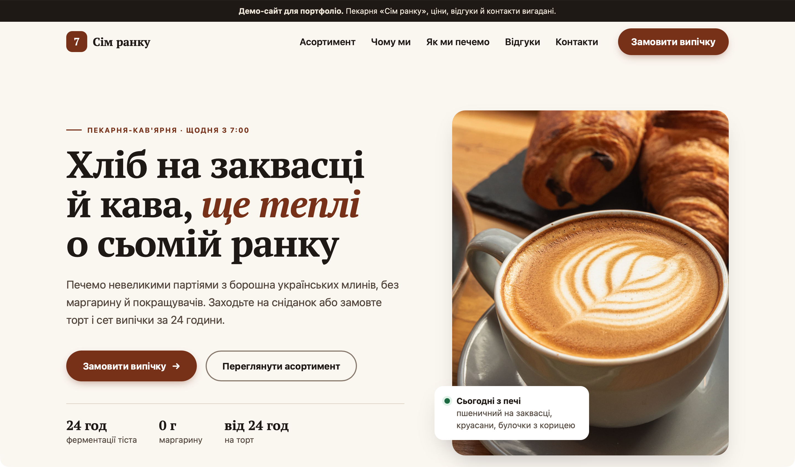
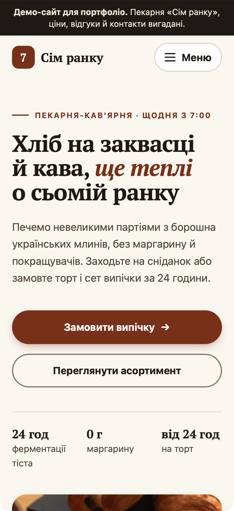
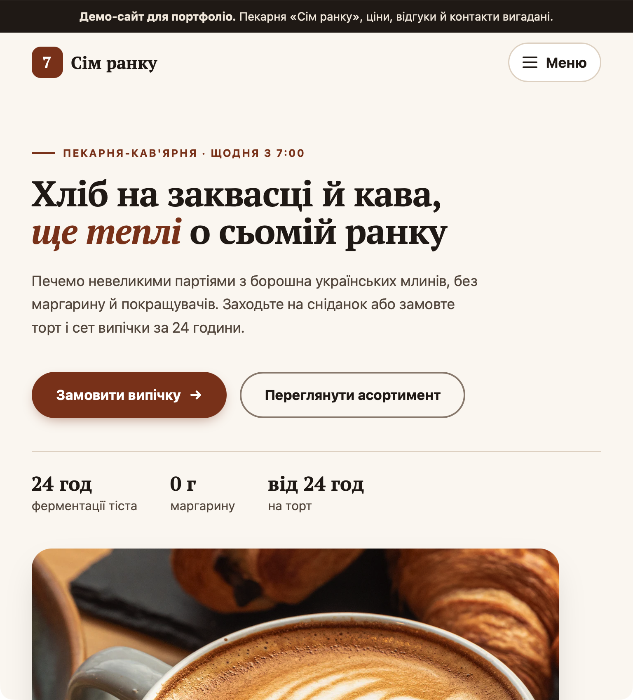

# «Сім ранку» — сайт пекарні-кав'ярні (демо)

Адаптивний односторінковий сайт для невеликої пекарні-кав'ярні. Демонстраційний проєкт для портфоліо:
бізнес, ціни, відгуки й контакти вигадані, сайт закритий від індексації.

**Живий сайт:** https://codebyalex22.github.io/sim-ranku-demo/



## Технології

- HTML5 із семантичною розміткою (`header`, `nav`, `main`, `section`, `figure`, `dl`).
- CSS: власні властивості (дизайн-токени), Grid і Flexbox, `clamp()` для адаптивних відступів і заголовків.
- JavaScript без фреймворків і залежностей (≈10 КБ).
- Без збирання, npm-пакетів, зовнішніх шрифтів, CDN і трекерів: усі файли локальні.
- Фото у WebP із `srcset`/`sizes`, відкладене завантаження зображень нижче першого екрана.

## Функції

- **Перший екран** із заголовком, двома діями та фото з `fetchpriority="high"`.
- **Асортимент:** 6 карток товарів із фото, вагою й ціною, прайс «Також щодня», блок замовлень і кейтерингу.
- **Розділи** «Чому ми», «Як ми печемо» (таймлайн), приклади відгуків і контакти.
- **Мобільне меню** на весь екран:
  - блокування прокрутки сторінки;
  - фокус не виходить за межі меню;
  - закриття через Escape, логотип, пункт меню або клік поза ним.
- **Форма заявки:**
  - перевірка полів на льоту, телефон або email;
  - зрозумілі повідомлення про помилки з `aria-invalid` та `aria-describedby`;
  - стани «завантаження», «помилка» й «успіх».
- **Мікроанімації** появи блоків і наведення; повністю вимикаються при `prefers-reduced-motion`.
- **Доступність:**
  - посилання «Перейти до основного вмісту»;
  - видима рамка фокуса, світла на темних блоках;
  - контраст тексту за WCAG AA;
  - `alt` у всіх фото.
- **Робота без JavaScript:** вміст і навігація доступні, форма вимкнена з поясненням.
- **SEO й соцмережі:** `title`, `description`, Open Graph із прев'ю 1200×630, `noindex` для демо.

## Адаптивність

Макет розрахований на ширини від 320 px.
Перевірено в Safari 27 і Chromium на 390, 768 і 1440 px.

| Мобільна (390 px) | Планшет (768 px) |
| --- | --- |
|  |  |

Усі знімки екрана: [`docs/screenshots/`](docs/screenshots/). Результати перевірок: [`docs/QA-REPORT.md`](docs/QA-REPORT.md).

## Локальний запуск

Збирання не потрібне. Достатньо будь-якого статичного сервера, наприклад Python 3:

```bash
python3 -m http.server 8000
```

Після цього відкрийте http://localhost:8000.

Рекомендовано відкривати сайт саме через локальний сервер, а не подвійним кліком по `index.html`.

## Демонстраційна форма

Форма **не надсилає дані**: серверного обробника немає.
Після правильного заповнення відвідувач бачить повідомлення «Демо-режим: заявку не надіслано…», а введений текст лишається у формі.

Щоб підключити реальне надсилання, вкажіть адресу обробника в атрибуті `data-endpoint` форми в `index.html`.
Скрипт надішле POST-запит із JSON `{ name, contact, message }` і покаже стани завантаження, помилки та успіху.
Перевірку даних і захист від спаму потрібно реалізувати на сервері.

## Перед використанням як реального сайту

- Замінити вигадані назву, ціни, відгуки й контакти-заглушки (`+380 00 000 00 00`, `hello@example.com`).
- Прибрати демо-смугу, мітки «Демо» й `<meta name="robots" content="noindex">`.
- Замінити адреси в `og:url` і `og:image` на власний домен: соцмережі читають лише повні адреси.
- Підключити обробник форми.

## Фото й ліцензії

Фотографії з [Unsplash](https://unsplash.com) за [Unsplash License](https://unsplash.com/license).
Автори та посилання на оригінали: [`images/CREDITS.md`](images/CREDITS.md).
Люди на фото не пов'язані з вигаданою пекарнею.

## Структура

```
index.html            сторінка
style.css             стилі
script.js             меню, анімації появи, форма
images/               фото (WebP), прев'ю для соцмереж, CREDITS.md
docs/QA-REPORT.md     звіт про тестування
docs/screenshots/     знімки екрана з Safari
```
